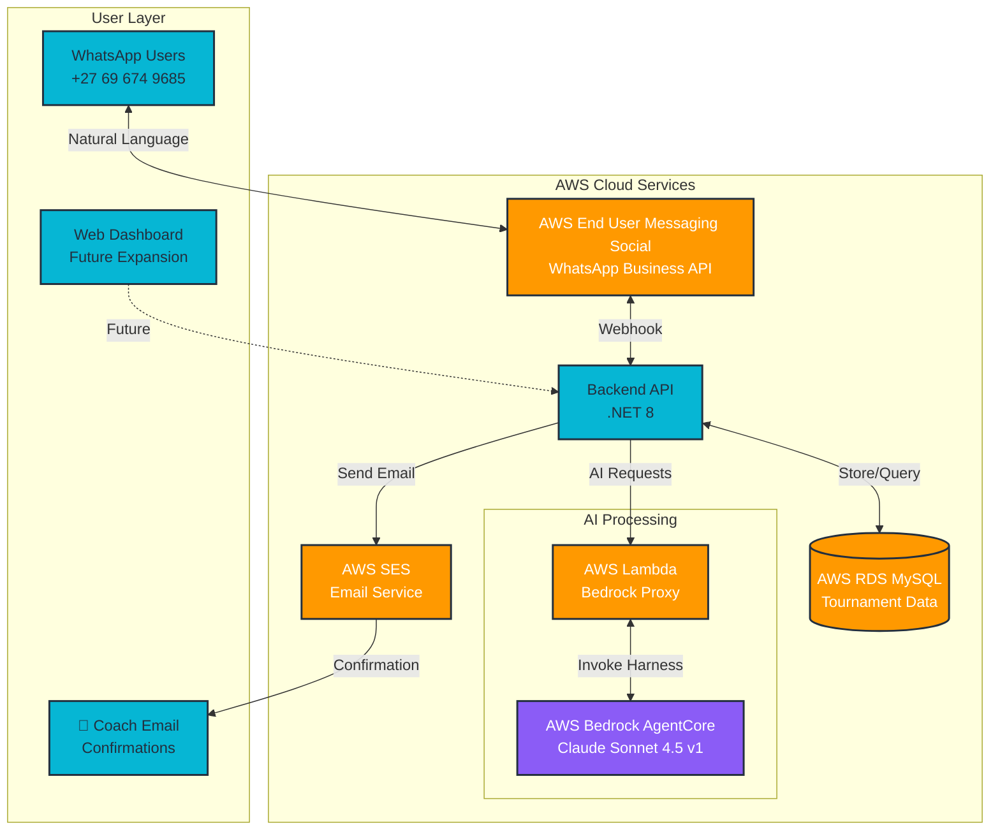

# SportHub - AI-Powered Sports Tournament Management System

## 📋 Project Overview

SportHub is an intelligent, multi-channel sports tournament management platform that leverages AWS Bedrock AgentCore to automate team registrations, fixture scheduling, and provide conversational support through WhatsApp and web interfaces.

---

## 🎯 Problem We're Solving

Sports tournament organizers, particularly in South Africa, face significant challenges:

1. **Manual Registration Process** - Coaches must fill lengthy web forms or make phone calls, creating friction and reducing participation
2. **Limited Accessibility** - Many coaches in townships lack consistent internet access but have WhatsApp on mobile
3. **Communication Delays** - Tournament updates via email often get missed; coaches prefer instant messaging
4. **Repetitive Q&A** - Organizers spend hours answering the same questions about rules, fees, and schedules
5. **Scheduling Complexity** - Manual fixture creation is time-consuming and error-prone with 50+ teams

---

## 💡 Our Solution

SportHub provides an **AI-powered conversational platform** accessible via WhatsApp (where coaches already are) and web interfaces, with:

### 🤖 Intelligent Conversational Registration
- Natural language team registration via WhatsApp - no forms, no websites needed
- AWS Bedrock AgentCore understands context, corrections, and natural speech
- Validates eligibility in real-time (age groups, event capacity)
- Automatic email confirmations sent upon completion

### 📱 WhatsApp-First Design
- Reaches 95%+ of South African smartphone users
- No app installation required
- Works on basic smartphones with limited data
- Familiar interface coaches already use daily

### 🧠 Context-Aware AI Assistant
- Remembers conversation history per user
- Handles corrections mid-conversation ("Actually, I meant U13, not U11")
- Task switching ("Wait, is the Women's event still open?")
- Provides event-specific information dynamically

### ⚡ Automated Fixture Generation
- Algorithm creates optimized schedules in seconds
- Conflict detection (no team plays twice at same time)
- Intelligent pitch allocation
- Instant notifications to all affected teams

### 🌐 Multi-Channel Architecture
- **WhatsApp Bot** for coaches (registration, queries, notifications)
- **Web API** for organizers (event management, reporting)
- **Unified Backend** ensures data consistency
- **Future**: Web dashboard, mobile app, SMS fallback

---

## 🏗️ Technical Architecture

### High-Level System Design



### Core Technology Stack

**AWS Services (3 CDS Services):**
1. **AWS Bedrock AgentCore** - Conversational AI with Claude Sonnet 4.5 v1
2. **AWS End User Messaging Social** - WhatsApp Business API integration
3. **AWS SES (Simple Email Service)** - Registration confirmation emails
4. **AWS Lambda** - Serverless Bedrock proxy (Python 3.12)
5. **AWS RDS MySQL** - Tournament data storage

**Backend:**
- .NET 8 REST API with clean architecture
- Entity Framework Core for data access
- Async/await for performance

**Communication:**
- WhatsApp as primary channel (+27 69 674 9685 - South African number)
- Email confirmations via SES (coach receives confirmation after registration)
- Natural language processing via Bedrock
- Real-time webhook integration

### Data Flow (Simplified)

**User Message → AI Response:**
```
WhatsApp User
    ↓
AWS End User Messaging Social
    ↓
.NET Backend API
    ↓
AWS Lambda (Bedrock Proxy)
    ↓
AWS Bedrock AgentCore (Claude Sonnet 4.5)
    ↓
Response back through stack to WhatsApp
    ↓
AWS SES sends confirmation email to coach
```

**Database Operations:**
- All registrations, fixtures, events stored in AWS RDS MySQL
- Real-time validation checks before confirming registrations
- Optimized queries for fast fixture retrieval

**Multi-Channel Notifications:**
- **WhatsApp:** Instant AI responses via AWS End User Messaging Social
- **Email:** Professional confirmation via AWS SES (includes event details, team info)

---

## ✨ Key Features & Functionality

### 1. Conversational Team Registration

**User Experience:**
```
Coach: "Hi"
Bot: "👋 Welcome to Amusema Sports! How can I help?
     • Register a team
     • Check fixtures
     • View event details"

Coach: "I want to register my team"
Bot: "Great! Which event?
     1. 🏆 Gauteng Schools Football Festival
     2. ⚽ Johannesburg Youth Soccer Cup
     3. 👩‍⚽ Women Soccer Launch"

Coach: "Is the women's event still open?"
Bot: "The Women Soccer Launch is fully booked (8/8 teams).
     Would you like to register for Johannesburg Cup instead?"

Coach: "Yes, register for Johannesburg"
Bot: "Perfect! What's your team name?"
```

**Behind the Scenes:**
- Bedrock understands intent ("register") and entity ("women's event")
- Checks database for real-time availability
- Switches context gracefully when coach changes their mind
- Validates team details against event requirements
- Stores registration with timestamp and confirmation

### 2. Intelligent Fixture Queries

**User Experience:**
```
Coach: "fixtures"
Bot: "📋 Your Upcoming Fixtures
     
     🏆 Women Soccer Launch
     U13 Women's
     ⚽ Phoenix Warriors vs Durban Waves
     ⏰ Kick-off: 08:00 | 📍 Pitch 1
     
     🏆 Women Soccer Launch
     U13 Women's
     ⚽ Phoenix Warriors vs Cape Town Roses
     ⏰ Kick-off: 14:00 | 📍 Pitch 1
     
     Good luck! 🏆"
```

**Behind the Scenes:**
- Identifies user by WhatsApp phone number
- Queries database for team(s) linked to that phone
- Fetches all fixtures for those teams
- Formats with event names, dates, times, venues
- Removes duplicates, sorts chronologically

### 3. Smart Age Group Validation

**User Experience:**
```
Bot: "Which age group? (U11, U13 available for this event)"
Coach: "U15"
Bot: "❌ U15 is not available for this event.
     Please choose: U11 or U13"
```

**Behind the Scenes:**
- Fetches age groups defined for selected event
- Validates coach input against allowed groups
- Provides helpful error messages with valid options
- Prevents invalid registrations before submission

### 4. Event Capacity Management

**User Experience:**
```
Coach: "Register for Women Soccer Launch"
Bot: "Unfortunately, the Women Soccer Launch is fully booked.
     
     Status: 8/8 teams registered
     Available spots: 0
     
     Would you like to register for another event?"
```

**Behind the Scenes:**
- Real-time query: SELECT COUNT(*) WHERE event_id = X
- Compares against event.max_teams
- Prevents overbooking
- Suggests alternatives

### 5. Automatic Fixture Generation

**Smart Algorithm:**
- Generates complete tournament schedules in seconds
- Round-robin format (each team plays every other team once)
- Conflict detection (no team plays twice at same time)
- Optimal pitch allocation
- Fair time distribution across all teams

**Benefits:**
- Saves 4+ hours of manual work
- Eliminates human error
- Instant notifications to all teams
- Easy regeneration if needed

### 6. Multi-Channel API

Backend API serves multiple clients:
- WhatsApp bot (current)
- Web dashboard (future)
- Mobile app (future)
- Third-party integrations (future)

Unified data model ensures consistency across all channels.

---

## 📊 Key Technical Achievements

### AWS Bedrock AgentCore Integration
- Built custom conversational agent using Claude Sonnet 4.5 v1
- Handles complex natural language: context switching, corrections, multi-turn conversations
- Session management maintains conversation history per user
- Streaming responses for low-latency interactions

### Serverless Architecture Benefits
- AWS Lambda auto-scales to handle registration spikes
- Pay-per-use model (no idle server costs)
- Fast cold starts (2-5 seconds)
- Seamless integration with Bedrock

### Multi-Channel Communication
- **WhatsApp:** AWS End User Messaging Social with South African number (+27)
- **Email:** AWS SES for professional confirmations with event details
- Character limit handling (1600 chars) with smart truncation
- Reliable delivery across both channels

### Database Design
- Normalized schema for events, teams, registrations, fixtures
- Optimized queries for real-time availability checks
- Transaction support for data consistency
- EU region (eu-west-1) for low latency to South Africa

---

## 🎯 Impact & Use Cases

### Real-World Scenarios

**Scenario 1: Township Coach with Limited Internet**
- Coach only has WhatsApp on basic smartphone
- Can register team in 2 minutes via natural conversation
- Receives fixture updates instantly on WhatsApp
- No need to visit website or download app

**Scenario 2: Tournament Organizer Managing 200+ Teams**
- Creates event via web API in minutes
- Fixture generation automated (was 4+ hours manual work)
- All coaches notified simultaneously via WhatsApp
- Real-time registration tracking

**Scenario 3: Last-Minute Registration Changes**
- Coach realizes they entered wrong age group
- WhatsApp: "Actually, change it to U11 please"
- Bot understands correction, updates database
- Confirmation sent immediately

### Scalability

**Current Capacity:**
- Handles 1000+ concurrent WhatsApp conversations
- Lambda auto-scales to demand (no manual intervention)
- Database supports 10,000+ teams per event
- Bedrock rate limits: 100 requests/minute (upgradeable)

---

## 🚀 Innovation & Differentiation

### What Makes SportHub Unique

1. **WhatsApp-First** - Meets users where they are (95% smartphone penetration in SA)
2. **True Conversational AI** - Not just pattern matching; understands context, corrections, natural language
3. **Serverless Architecture** - Lambda eliminates cold starts, scales infinitely
4. **Multi-Channel** - Same backend serves WhatsApp, web, future SMS/mobile app
5. **Production-Ready** - Clean code, error handling, documentation, deployment automation

---

## 📈 Future Enhancements

### Phase 2 (Post-Hackathon)
- [ ] React admin dashboard
- [ ] Live score updates via WhatsApp
- [ ] Team standings and leaderboards
- [ ] Payment integration (Paystack/PayFast)

### Phase 3 (Scale)
- [ ] Multi-language support (Zulu, Xhosa, Afrikaans, Sotho)
- [ ] WhatsApp Business API (verified number)
- [ ] SMS fallback for non-WhatsApp users
- [ ] Mobile app (Flutter)
- [ ] Referee assignment automation
- [ ] Weather-based rescheduling

### Phase 4 (AI-Powered)
- [ ] Predictive analytics (team performance)
- [ ] Automatic opponent matching based on skill level
- [ ] AI-generated highlight reels
- [ ] Voice notes transcription and processing

---

## 🎓 What We Learned

### AWS Technologies Mastered
- **Bedrock AgentCore Harness** - Built production conversational AI agent from scratch
- **AWS Lambda** - Serverless architecture for AI workload management
- **AWS End User Messaging Social** - WhatsApp Business API integration
- **AWS SES** - Professional email delivery system
- **Multi-Service Orchestration** - Connected Lambda, RDS, Bedrock, WhatsApp, SES seamlessly

### Technical Growth
- Natural language processing and intent recognition
- Webhook architecture for real-time messaging
- Multi-channel notification systems (WhatsApp + Email)
- Clean architecture patterns in .NET
- Database optimization for tournament data
- Error handling in distributed systems
- Production deployment and monitoring

---

## 📞 Try It Yourself!

**WhatsApp Bot:** Message `Hi` to **+27 69 674 9685** (South African number)  
**GitHub:** https://github.com/sportshub-hackerthon/SportHub  
**Live API:** https://sporthub-rng4.onrender.com

---

## 👥 Team

**Developers:** Precious Mokgoebo, Shereen Ncube, Athuli Ntintili  
**Organization:** Umdoko Internet  
**Email:** precious.mokgoebo@umdoko.com

---

**Built for AWS Hackathon 2026** 🏆

*Empowering sports communities with intelligent AI automation*
