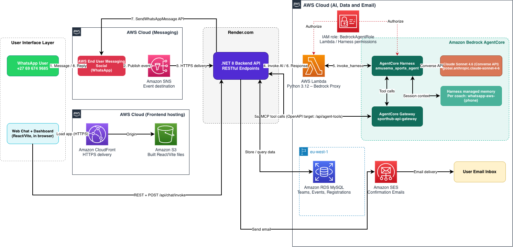

# SportHub: AI Sports Tournament Management over WhatsApp & Web Chat 🏆

**AWS CDS Agentic AI Hackathon 2026** · Built by Umdoko Internet, South Africa 🇿🇦

Coaches register teams, check fixtures and get updates through natural conversation—via **WhatsApp** or **web chat**. No forms, no app downloads required. Natural conversation is handled by an agent on **Amazon Bedrock AgentCore** (Claude Sonnet 4.6), with WhatsApp connected through **AWS End User Messaging Social**.

<!-- **� [Watch 3-minute demo](https://youtu.be/VIDEO_ID)** (coming soon) -->

**�💬 Try it live:**
- **Web Chat:** [https://d4t6kc08b3ljm.cloudfront.net/](https://d4t6kc08b3ljm.cloudfront.net/) (React app, hosted on CloudFront)
- **WhatsApp:** [+27 69 674 9685](https://wa.me/27696749685) (South African number)
- **API:** [Swagger Documentation](https://sporthub-rng4.onrender.com/swagger) (for developers)

**📖 [Technical Details](PROJECT_DESCRIPTION.md)**

---

## The problem

Township coaches have smartphones with WhatsApp, but limited data makes web registration forms hard to use. Organisers end up collecting registrations by phone call and message, then typing them in by hand. SportHub lets a coach just talk to register.

## Architecture



**Key Flow:**
```
Web Chat user → CloudFront (S3) → .NET API
WhatsApp user → AWS End User Messaging Social → SNS → .NET API (Render)
   ↓
.NET API → AWS Lambda (Python 3.12, Bedrock proxy)
   ↓
AWS Lambda → Bedrock AgentCore Harness (amusema_sports_agent)
   ├── Claude Sonnet 4.6 via Converse API
   ├── Harness-managed memory (per session)
   └── AgentCore Gateway ──► .NET API /api/agent-tools endpoints ──► RDS MySQL
   ↓
Response: Lambda → .NET API → WhatsApp/Web Chat
Emails: .NET API → Amazon SES → coach's email
```

### AWS services

| Service | Role in SportHub |
|---|---|
| **Amazon Bedrock AgentCore** (Harness, Gateway, Memory) | Conversational agent, tool access and per-session memory *(primary CDS service)* |
| **AWS End User Messaging Social** | WhatsApp Business integration, inbound and outbound *(CDS service)* |
| **Amazon SES** | Registration confirmation emails *(CDS service)* |
| **Amazon SNS** | Delivers inbound WhatsApp events to the backend |
| **AWS Lambda** (Python 3.12) | Serverless proxy that invokes the harness |
| **Amazon RDS MySQL** (eu-west-1) | Teams, events, registrations and fixtures |
| **Amazon S3** | Hosts web chat React app static files |
| **Amazon CloudFront** | CDN for web chat app (https://d4t6kc08b3ljm.cloudfront.net/) |
| **AWS IAM** | Roles for Lambda and the harness (`BedrockAgentRole`) |
| **AWS End User Messaging Social** | WhatsApp Business integration, inbound and outbound *(CDS service)* |
| **Amazon SES** | Registration confirmation emails *(CDS service)* |
| **Amazon SNS** | Delivers inbound WhatsApp events to the backend |
| **AWS Lambda** (Python 3.12) | Serverless proxy that invokes the harness |
| **Amazon RDS MySQL** (eu-west-1) | Teams, events, registrations and fixtures |
| **Amazon S3** | Hosts web chat React app static files |
| **Amazon CloudFront** | CDN for web chat app (https://d4t6kc08b3ljm.cloudfront.net/) |
| **AWS IAM** | Roles for Lambda and the harness (`BedrockAgentRole`) |

Model: `global.anthropic.claude-sonnet-4-6` (Bedrock Converse API).

---

## Quick start for judges

### Option A: Test the live deployment (about 2 minutes, nothing to install)

1. **Wake the backend.** It runs on Render's free tier, which sleeps after about 30 minutes, so the first request can take 30 to 60 seconds. Open the [Swagger page](https://sporthub-rng4.onrender.com/swagger) and wait for it to load.

2. **Choose your testing method:**
   - **WhatsApp:** Message **+27 69 674 9685** (recommended for full experience)
   - **Web Chat API:** Use Swagger → `POST /api/Chat/invoke` with JSON: `{"message": "Hi", "sessionId": "test-123"}`

3. Try this conversation:

| You send | Expected reply |
|---|---|
| `Hi` | Welcome message with options |
| `Show me upcoming events` | List of open events |
| `Is the women's event still open?` | Availability answer, with an alternative if it is full |
| `I want to register my team` | Walks you through event, team name, school, age group and coach details |
| `Actually, change that to U11` | Corrects the earlier answer mid-conversation |
| `YES` (at the summary) | Registration saved, confirmation email sent |
| `fixtures` | Your team's fixtures |

> **Note:** Both WhatsApp and Web Chat use the same Bedrock AgentCore backend, so the conversation experience is identical.
>
> **Email note:** if Amazon SES is still in sandbox mode, confirmation emails are only delivered to verified addresses. Either verify a test email address in the SES console, or move SES to production mode (requires AWS support ticket) to send to any address.

### Option B: Run it yourself

#### Prerequisites

- .NET 8 SDK and MySQL 8.0+
- Python 3.12 and AWS CLI configured (`aws configure`)
- An AWS account in **eu-west-1** with access to Bedrock AgentCore, End User Messaging Social, Lambda, RDS, SES and SNS
- Claude Sonnet 4.6 enabled in Amazon Bedrock
- A Meta business account and a WhatsApp Business phone number registered in End User Messaging Social (the slowest step; allow extra time)

#### 1. Clone

```bash
git clone https://github.com/sportshub-hackerthon/SportHub.git
cd SportHub
```

#### 2. Create the database

```bash
mysql -h <your-rds-endpoint> -u admin -p < backend/init-rds-database.sql
```

The script creates the schema and seed data (events and age groups used in the demo).

#### 3. Deploy the Lambda proxy

```bash
cd backend
./deploy_lambda.sh
```

This creates a virtual environment, installs `boto3`, zips `lambda_function.py` and uploads it to Lambda. Expose it with a Lambda Function URL or an API Gateway endpoint and note the URL for step 6. Give the function's role permission to call `bedrock-agentcore:InvokeHarness` on your harness.

#### 4. Create the AgentCore harness, memory and gateway

In the AWS console, open **Bedrock AgentCore** and create:

1. A **Gateway** (we used `sporthub-api-gateway`) whose target is an OpenAPI schema describing the `/api/agent-tools` endpoints (create-event, register-team, get events, registration status).
2. A **Harness** (we used `amusema_sports_agent`) with:
   - Model: `global.anthropic.claude-sonnet-4-6`, Converse API
   - System prompt: copy from [`backend/bedrock-system-prompt.md`](backend/bedrock-system-prompt.md)
   - Memory: harness-managed, semantic and summarization strategies
   - Tool: the gateway from step 1
   - IAM role: `BedrockAgentRole` (needs Bedrock model access and gateway permissions)

#### 5. Configure the backend

Set these as environment variables (the double underscore maps to nested JSON keys in .NET). Do not commit secrets.

| Variable | What it's for |
|---|---|
| `ConnectionStrings__Default` | `Server=<rds-endpoint>;Port=3306;User=admin;Password=<password>;Database=sporthub;` |
| `AWS__Region` | `eu-west-1` |
| `AWS__WhatsAppPhoneNumberId` | Your WhatsApp phone number ID from End User Messaging Social |
| `AWS__WhatsAppBusinessAccountId` | Your WhatsApp business account ID (`waba-...`) |
| `AWS__WhatsAppVerifyToken` | Any secret string for webhook verification |
| `AWS__BedrockAgentId` | Your Bedrock harness ID |
| `Bedrock__PythonServiceUrl` | The Lambda URL from step 3 |
| `AWS__BedrockAccessKeyId` / `AWS__BedrockSecretAccessKey` | IAM credentials for calling Lambda and the AI agent |
| `AWS_ACCESS_KEY_ID` / `AWS_SECRET_ACCESS_KEY` | IAM credentials for sending WhatsApp messages (`social-messaging:SendWhatsAppMessage`) and emails (`ses:SendEmail`) |

> **Note:** Both credential pairs can use the same IAM user if that user has all required permissions.

#### 6. Connect WhatsApp to the backend

1. Create an **SNS topic** (Standard), for example `sporthub-whatsapp-events`.
2. Create an **HTTPS subscription** to `https://<your-backend-url>/api/aws-whatsapp/webhook`, then confirm it (status must be *Confirmed*).
3. In **End User Messaging → WhatsApp → Phone numbers**, open your number and set the **event destination** to the SNS topic.

#### 7. Run

```bash
cd backend/src/SportHub
dotnet run
```

The API is at `http://localhost:5000` (Swagger at `/swagger`). The solution file `SportHub.slnx` in `backend/` contains a single project, `src/SportHub/SportHub.csproj`. `dotnet run` as above works with the .NET 8 SDK. To open or build the `.slnx` file itself (`dotnet build SportHub.slnx`, or in an IDE) you need .NET SDK 9.0.200 or newer, or a recent Visual Studio. For WhatsApp to reach a local machine, expose it with a tunnel such as ngrok and use that URL in the SNS subscription, or deploy to any host.

#### 8. Test without WhatsApp

You can exercise the AI agent directly through `ChatController` in Swagger (`POST /api/chat/invoke`), which skips the WhatsApp and SNS steps. This is the fastest way to confirm the Lambda, harness and gateway are wired up.

Alternatively, test the live web chat at https://d4t6kc08b3ljm.cloudfront.net/

---

## How a message flows

1. The coach sends a WhatsApp message to the business number.
2. AWS End User Messaging receives it and publishes the event to SNS.
3. SNS delivers it to the backend webhook.
4. The backend extracts the text and phone number and builds a session ID: `whatsapp-aws-{phone}`, padded to 33 characters (the harness requires a minimum session ID length).
5. The backend calls the Lambda proxy, which invokes the AgentCore harness.
6. Claude reasons over the message and the coach's memory, and calls tools through the gateway when it needs data (events, registrations, fixtures).
7. The reply returns to the backend, which sends it with `SendWhatsAppMessage`.
8. On a confirmed registration the backend also sends a confirmation email through SES.

Because the session ID is derived from the phone number, each coach keeps their own conversation history across messages.

## Features

- **Multi-channel access**: Same AI conversation experience via WhatsApp (`/api/aws-whatsapp/webhook`), Web Chat App (CloudFront), or Web Chat API (`/api/chat/invoke`)
- **Conversational registration**: natural language, mid-conversation corrections ("Actually, change that to U11"), and a summary the coach must confirm with YES before anything is saved
- **Context and memory**: per-session memory with harness-managed semantic and summarization strategies
- **Real-time checks**: event capacity and age group validation, with alternatives suggested when an event is full
- **Fixture generation**: round-robin schedules per age group, pitch allocation and clash detection (`POST /api/Fixtures/generate/{eventId}`)
- **Notifications**: WhatsApp messages and email confirmations via SES
- **REST API**: .NET 8, Clean Architecture (Domain, Application, Infrastructure, API), repository pattern, MySQL on RDS

## Project structure

```
SportHub/
├── backend/
│   ├── src/SportHub/
│   │   ├── API/Controllers/          # Events, Teams, Registrations, Fixtures, AwsWhatsAppWebhook, Chat
│   │   ├── Application/Services/     # Event, Team, Registration, Fixture, AwsWhatsApp, EmailNotification, BedrockHarness
│   │   ├── Domain/Entities/          # Event, Team, Registration, Fixture, Notification
│   │   └── Infrastructure/Data/      # DbContext and repositories
│   ├── lambda_function.py            # Lambda Bedrock proxy
│   ├── lambda_requirements.txt
│   ├── deploy_lambda.sh
│   ├── bedrock-system-prompt.md      # AgentCore harness system prompt
│   └── init-rds-database.sql         # Schema and seed data
├── docs/images/                      # Architecture diagram, screenshots
├── PROJECT_DESCRIPTION.md            # Full technical documentation
└── README.md
```

## Troubleshooting

**No reply on WhatsApp**
- Check the SNS subscription status is *Confirmed*.
- Check the phone number's event destination points at your SNS topic.
- Wake the backend (open Swagger) and check the Render logs.

**The agent doesn't respond or errors**
- Check the Lambda's CloudWatch logs.
- Confirm the Lambda role can invoke the harness, and `BedrockAgentRole` can use the model and the gateway.
- Check `Bedrock__PythonServiceUrl` is correct, and test the Lambda directly with `curl`.

**The agent can't find events or teams**
- Check the gateway target points at a reachable backend URL.
- Check the backend can reach RDS (security group must allow the backend's address).

**Database connection errors**
- Check the connection string, that the `sporthub` database exists, and that `init-rds-database.sql` ran.

## Known limitations

- **Hosting:** the demo backend runs on Render's free tier, so it sleeps when idle and the first request is slow.
- **Security for production:** the harness currently allows all tools (`*`) and has a public network setting. Production would restrict allowed tools to the registration, fixture and event operations, and add authentication on the gateway's calls to the API.
- **Model routing:** the global inference profile may process conversation text in other AWS regions. Stored data stays in eu-west-1.
- **WhatsApp rules:** proactive messages outside an open conversation need approved message templates.
- **Scale:** Lambda and Bedrock scale on demand, but we have not load tested the full system, and the backend and database are sized for the demo.

## Team

**Umdoko Internet**: Precious Mokgoebo, Shereen Ncube, Athuli Ntintili

📧 precious.mokgoebo@umdoko.com · 🐙 [github.com/sportshub-hackerthon/SportHub](https://github.com/sportshub-hackerthon/SportHub)

## License

MIT. See the `LICENSE` file.

## Acknowledgments

AWS for Bedrock AgentCore and End User Messaging, Anthropic for Claude, and the South African township sports communities who inspired this.
